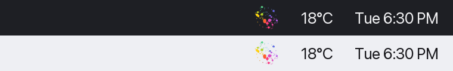
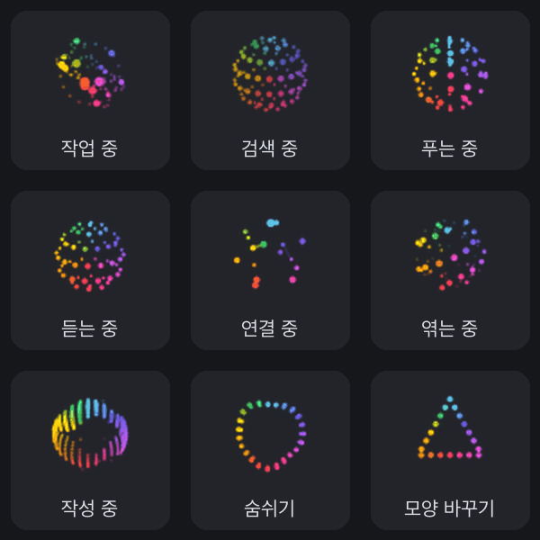
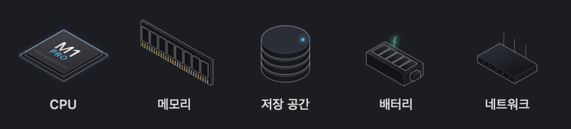

# OrbMeter

맥 메뉴 막대에서 살아 움직이는 CPU 미터입니다. 색색의 도트로 된 오브가 CPU를 많이 쓸수록 빨리 돕니다. 숫자를 읽지 않아도 곁눈으로 부하를 느낄 수 있습니다. 오브를 누르면 CPU, 메모리, 저장 공간, 배터리, 네트워크를 보여 주는 대시보드가 열립니다. 항목마다 작은 아이소메트릭 하드웨어 렌더가 그 숫자에 맞춰 빛나고 움직입니다.

[English](README.md) · **한국어**



- **오브 9종.** [Thinking Orbs](https://libraries.dev/orbs)의 모든 상태를 러너로 고를 수 있습니다. 작업 중, 검색 중, 푸는 중, 듣는 중, 연결 중, 엮는 중, 작성 중, 숨쉬기, 모양 바꾸기.
- **속도가 곧 부하.** 오브는 기본 속도의 CPU% ÷ 5배(1~20배)로 움직입니다. CPU 20% 언저리에서 원래 속도로 돌고, 큰 빌드를 돌리면 내달립니다. 반대로 부하가 클수록 느려지게 바꿀 수도 있습니다.
- **애플풍 색.** 도트 색은 원 둘레의 위치로 정해집니다. 파랑에서 보라, 핑크, 빨강, 주황, 노랑, 초록으로 이어지고, 루프 한 번마다 팔레트가 한 바퀴 돌며 은은하게 숨 쉽니다.
- **메뉴 막대에 맞춘 크기.** 22pt 상태 막대 칸을 레티나 해상도로 꽉 채우도록 그렸고, 오브마다 여백을 잘라 칸에 맞게 키웠습니다.
- **살아 있는 대시보드.** 각 항목은 SwiftUI로 직접 그린 아이소메트릭 렌더입니다. CPU는 시스템에서 읽은 내 칩(예: M1 PRO)으로, 부하가 오를수록 코어 10개가 차례로 빛나고 칩 위로 빛 반사가 지나갑니다. 메모리는 RAM 모듈의 칩이 사용량만큼 빛나며 튀어나옵니다. 저장 공간은 디스크 스택에 빛나는 링이 차오르고 읽기 헤드가 돕니다. 배터리는 충전 중이면 셀이 초록으로 맥동하고, 네트워크는 트래픽이 많은 방향으로 안테나가 기울며 LED가 깜빡입니다. 대시보드를 열면 그림이 차오르고, 그 뒤에도 저절로 계속 움직입니다.
- **가벼운 네이티브 앱.** Swift와 SwiftUI로 만들었고, 아이콘을 매번 다시 그리지 않고 Core Animation 키프레임 레이어로 움직입니다. RunCat 팀이 잰 이 방식의 CPU 사용량은 0.1% 정도입니다.





## 설치

필요한 것: Apple Silicon Mac, macOS 26 이상.

### 내려받기

1. [Releases](https://github.com/fl03er/OrbMeter/releases/latest)에서 `OrbMeter-<버전>.zip`을 내려받아 압축을 풉니다.
2. `OrbMeter.app`을 `응용 프로그램`으로 옮깁니다.
3. Apple 공증(유료 개발자 계정 필요)을 받지 않은 앱이라 처음 열 때 "Apple이 확인할 수 없습니다"라며 막힙니다. **시스템 설정 → 개인정보 보호 및 보안**에서 OrbMeter 옆의 **그래도 열기**를 누르거나, 터미널에서 한 번 실행하세요.

   ```bash
   xattr -dr com.apple.quarantine /Applications/OrbMeter.app
   ```

**로그인 시 자동 실행:** 오브를 누르고 설정(톱니바퀴) → 일반 → *로그인 시 OrbMeter 자동 실행*을 켜세요.

### 소스에서 빌드

Xcode 26.5 이상이 필요합니다.

```bash
git clone https://github.com/fl03er/OrbMeter.git
cd OrbMeter
xcodebuild -project RunCatNeo.xcodeproj -scheme RunCatNeo -configuration Release \
  -destination 'platform=macOS,arch=arm64' -derivedDataPath /tmp/orbmeter-build \
  -skipPackagePluginValidation CODE_SIGN_IDENTITY=- build
cp -R /tmp/orbmeter-build/Build/Products/Release/OrbMeter.app /Applications/
```

`-derivedDataPath`는 iCloud Drive로 동기화되는 폴더(데스크탑, 문서 등) 밖으로 두세요. 그 폴더들이 붙이는 확장 속성 때문에 코드 서명이 실패합니다.

## 사용법

- **오브 고르기:** 오브 → 설정 → 러너, 또는 대시보드 메뉴에서 고릅니다.
- **대시보드:** CPU와 사용량 그래프, 메모리, 저장 공간, 배터리, 네트워크. 설정 → 메트릭에서 항목을 켜고 끕니다.
- **사용자 지표:** 로컬 JSON 파일을 지켜보다가 카드로 보여 줍니다. Claude Code 사용량이나 GPU 온도 같은 것을 띄울 수 있습니다. [JSON 스키마](docs/CustomMetricsSchema.md)와 [Claude Code](docs/samples/claude-code/), [Codex](docs/samples/codex/), [비트코인](docs/samples/bitcoin/) 예시를 참고하세요.
- **나만의 러너:** 설정 → 러너에서 키프레임 애니메이션을 사용자 러너로 추가할 수 있습니다.

## 프레임 만들기

오브는 미리 렌더링한 PNG 프레임입니다. [`tools/orb-frames`](tools/orb-frames/)의 스크립트가 `thinking-orbs` 엔진으로 만듭니다. 밀도, 도트 크기, 밝기, 루프 길이, 확대 비율은 `render.mjs` 맨 위의 상수로 조절합니다.

스크립트는 상태마다 움직임이 거의 반복되는 루프 길이를 찾고, 루프의 마지막 35%를 시작 화면과 크로스페이드해 이음매가 튀지 않게 합니다. 4배 슈퍼샘플링으로 그리고, 도트마다 중심을 기준으로 한 각도로 색을 입힙니다. 팔레트는 루프 한 번에 정확히 한 바퀴 돌아서 색도 끊김 없이 이어집니다.

## 출처와 라이선스

OrbMeter는 Takuto Nakamura([@Kyome22](https://github.com/Kyome22))와 RunCat 기여자들이 만든 [RunCat Neo](https://github.com/runcat-dev/RunCatNeo)의 포크이며, [Apache License 2.0](LICENSE)을 따릅니다. 메뉴 막대 엔진, 대시보드, 지표, 설정, 사용자 러너는 원작자들의 작업입니다. 원조 달리는 고양이가 좋다면 [App Store의 RunCat Neo](https://apps.apple.com/us/app/runcat-neo/id6757801838)를 받아 원작자를 응원해 주세요.

오브 모션은 Jakub Antalik의 [thinking-orbs](https://github.com/Jakubantalik/Libraries.dev)(MIT 라이선스)에서 가져왔습니다. 대시보드의 얇은 선 아이소메트릭 느낌은 Lucas Marques의 [hairline](https://www.npmjs.com/package/@lucasmarkes/hairline)에서 영감을 받았고, 그림 자체는 새로 그렸습니다.

RunCat Neo에서 바뀐 점:

- 기본 러너를 thinking-orbs 상태 9종으로 바꾸고 22pt 컬러 프레임으로 렌더링했습니다. 원래 있던 동물 러너는 뺐습니다.
- 러너 프레임을 18pt 대신 22pt로 맞추고 상태 막대 칸의 세로 가운데에 놓습니다.
- 앱 이름을 OrbMeter로 바꾸고 번들 ID를 따로(`com.fl03er.OrbMeter`) 두어 RunCat Neo와 같이 설치할 수 있습니다.
- 대시보드의 지표 아이콘을 수치에 따라 움직이는 아이소메트릭 렌더로 바꿨습니다(`MetricFigureView.swift`, `SystemInfo+Figure.swift`).
- 후원 탭을 뺐습니다. 그 인앱 결제는 RunCat Neo의 App Store 등록에 묶여 있습니다.
- `tools/orb-frames`와 `docs/orbs`를 새로 넣었습니다.

OrbMeter는 RunCat 개발자들과 관련이 없고, 그들의 보증을 받지 않았습니다.
