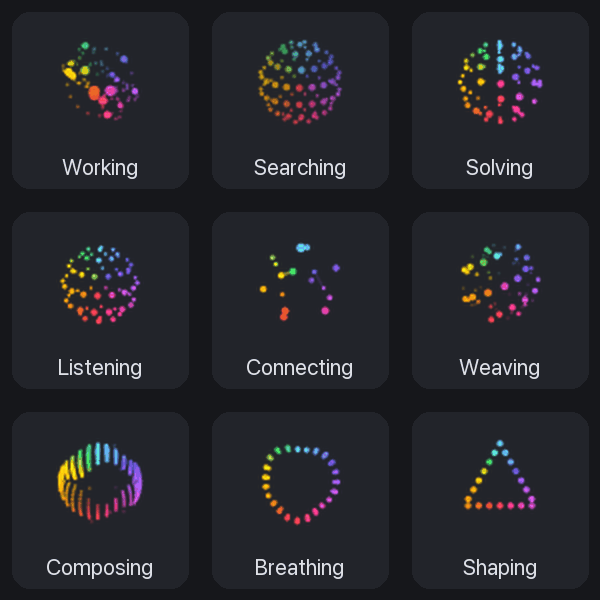
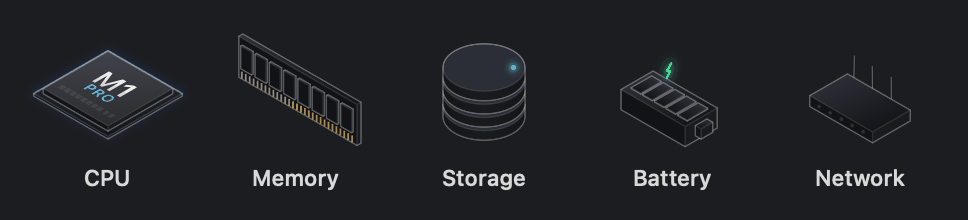

# OrbMeter


https://github.com/user-attachments/assets/6c10e8dc-9ee9-4b24-a2b8-0c9899626e24


A living CPU meter for the Mac menu bar. A glowing orb of colored dots spins faster as your CPU works harder, so you can feel the load from the corner of your eye without reading a number. Click it for a dashboard with CPU, memory, storage, battery and network, each drawn as a small isometric hardware render that lights up and moves with its number.

**English** · [한국어](README.ko.md)


- **Nine orbs.** Every state from [Thinking Orbs](https://libraries.dev/orbs) is a runner you can pick: Working, Searching, Solving, Listening, Connecting, Weaving, Composing, Breathing and Shaping.
- **Speed is the load.** The orb plays at CPU% ÷ 5 times its base rate (1× to 20×). Around 20% CPU it moves at its natural pace; under a heavy build it races. You can flip it so it slows down under load instead.
- **Apple-style color.** Dots take their color from where they sit around the circle, blue through violet, pink, red, orange, yellow and green, and the palette turns and gently breathes once per loop.
- **Sized for the menu bar.** Frames are drawn for the full 22 pt status item at Retina resolution, with each orb zoomed to fill it.
- **A living dashboard.** Each metric is an isometric render drawn natively in SwiftUI: your own chip (read from the system, such as M1 PRO) with ten cores that glow in turn as load rises and a sheen across the lid; a memory module whose packages light and push out as RAM fills; platters with a glowing fill ring and a circling read head; a battery whose cells pulse green on power; and a router whose antennas lean toward the busier direction while its LEDs blink with traffic. The figures fill up when the dashboard opens and keep moving on their own.
- **Native and light.** Swift and SwiftUI, animated with a Core Animation keyframe layer rather than redrawing the icon. The RunCat team measured that approach at about 0.1% CPU.





## Install

Requirements: macOS 26 or later on Apple Silicon.

### Download

1. Download `OrbMeter-<version>.zip` from [Releases](https://github.com/fl03er/OrbMeter/releases/latest) and unzip it.
2. Move `OrbMeter.app` to `Applications`.
3. The app isn't notarized by Apple (that needs a paid developer account), so the first launch is blocked with "Apple could not verify…". Either open **System Settings → Privacy & Security** and click **Open Anyway** next to OrbMeter, or run once:

   ```bash
   xattr -dr com.apple.quarantine /Applications/OrbMeter.app
   ```

**Start at login:** click the orb → settings (gear) → General → *Launch OrbMeter automatically at login*.

### Build from source

Needs Xcode 26.5 or later.

```bash
git clone https://github.com/fl03er/OrbMeter.git
cd OrbMeter
xcodebuild -project RunCatNeo.xcodeproj -scheme RunCatNeo -configuration Release \
  -destination 'platform=macOS,arch=arm64' -derivedDataPath /tmp/orbmeter-build \
  -skipPackagePluginValidation CODE_SIGN_IDENTITY=- build
cp -R /tmp/orbmeter-build/Build/Products/Release/OrbMeter.app /Applications/
```

Keep `-derivedDataPath` outside folders synced by iCloud Drive (such as Desktop or Documents): the extended attributes they add make code signing fail.

## Using it

- **Pick an orb:** click the orb → settings → Runner, or choose from the dashboard menu.
- **Dashboard:** CPU with a history graph, memory, storage, battery and network. Turn sections on or off in settings → Metrics.
- **Custom metrics:** OrbMeter can watch any local JSON file and show it as a card, for example Claude Code usage or GPU temperature. See the [JSON schema](docs/CustomMetricsSchema.md) and the samples for [Claude Code](docs/samples/claude-code/), [Codex](docs/samples/codex/) and [Bitcoin](docs/samples/bitcoin/).
- **Your own runner:** add any keyframe animation as a custom runner in settings → Runner.

## Making the frames

The orbs are prerendered PNG frames, generated from the `thinking-orbs` engine by the scripts in [`tools/orb-frames`](tools/orb-frames/). Density, dot size, brightness, loop length and zoom are constants at the top of `render.mjs`.

For each state the script finds a loop length where the motion nearly repeats, and crossfades the last 35% of the loop into its start so the wrap never jumps. It renders at 4× supersampling, colors each dot by its angle around the center, and turns the palette one full revolution per loop so the color loop is seamless too.

## Credits and license

OrbMeter is a fork of [RunCat Neo](https://github.com/runcat-dev/RunCatNeo) by Takuto Nakamura ([@Kyome22](https://github.com/Kyome22)) and the RunCat contributors, licensed under the [Apache License 2.0](LICENSE). The menu bar engine, dashboard, metrics, settings and custom runners are theirs. If you like the original running cat, get [RunCat Neo on the App Store](https://apps.apple.com/us/app/runcat-neo/id6757801838) and support its authors.

The orb motion comes from [thinking-orbs](https://github.com/Jakubantalik/Libraries.dev) by Jakub Antalik, MIT License. The dashboard's thin-line isometric look was inspired by [hairline](https://www.npmjs.com/package/@lucasmarkes/hairline) by Lucas Marques; the figures themselves are drawn from scratch.

Changes from RunCat Neo:

- The built-in runners are the nine thinking-orbs states, rendered as color frames at 22 pt; the original animal runners are removed.
- Runner frames are normalized to 22 pt and centered in the status item instead of 18 pt.
- The app is renamed to OrbMeter with its own bundle identifier (`com.fl03er.OrbMeter`), so it can sit next to RunCat Neo.
- The dashboard's metric icons are replaced by animated isometric renders driven by each metric (`MetricFigureView.swift`, `SystemInfo+Figure.swift`).
- The donation tab is removed, since its in-app purchases belong to RunCat Neo's App Store listing.
- `tools/orb-frames` and `docs/orbs` are new.

OrbMeter is not affiliated with or endorsed by the RunCat developers.
